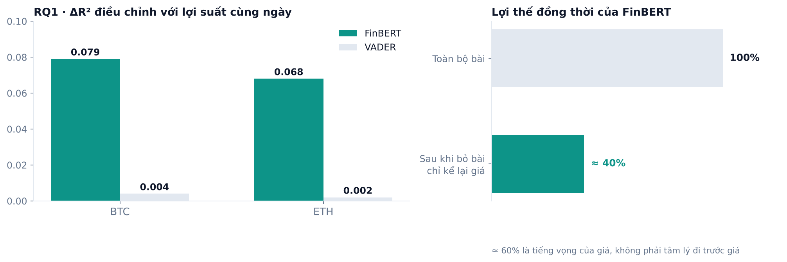
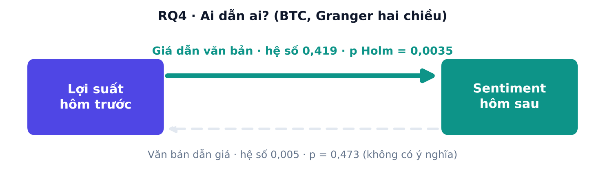
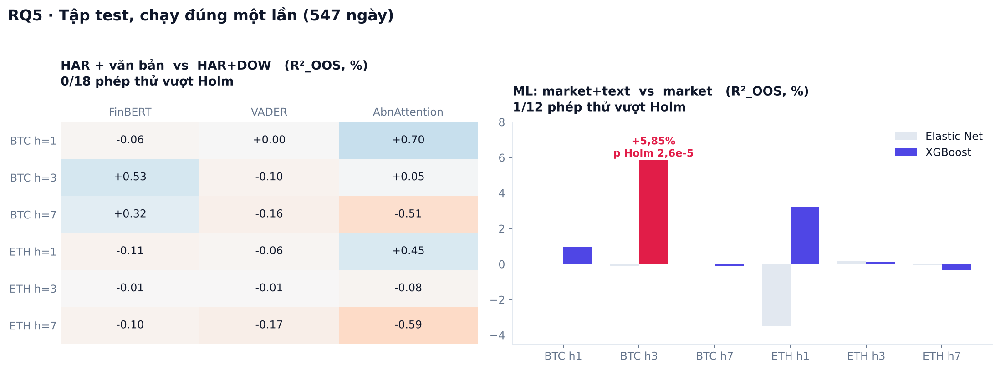
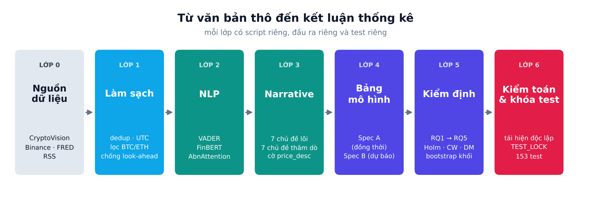
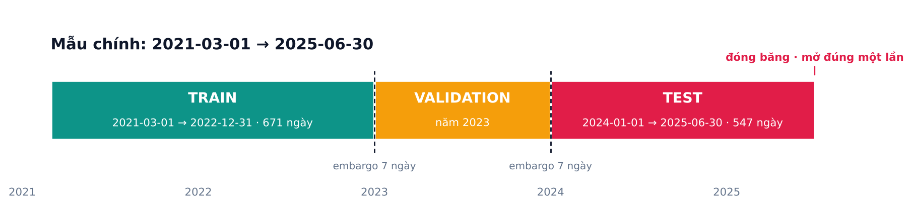

<div align="center">

# Crypto Narrative & NLP Sentiment Intelligence

### Tin tức crypto có *dẫn* giá, hay chỉ *kể lại* giá?

Một pipeline NLP và kinh tế lượng hoàn chỉnh, đi từ **62.758 bài báo thô** đến **kết luận thống kê** cho Bitcoin và Ethereum.


[Kết quả](#kết-quả-trong-một-phút) · [Kiến trúc](#kiến-trúc-bảy-lớp) · [Chạy thử](#bắt-đầu-nhanh) · [Hướng dẫn chi tiết](#hướng-dẫn-chạy-từng-bước) · [FAQ](#câu-hỏi-thường-gặp)

</div>

---

## Con số nhanh

| 62.758 | 4 | 630 | 547 | 1 | 153 |
|:---:|:---:|:---:|:---:|:---:|:---:|
| bài báo trong mẫu chính | nguồn tin ổn định | tiêu đề gán nhãn tay | ngày test | lần mở tập test | test tự động |

---

## Dự án này giải quyết vấn đề gì

Mỗi ngày có hàng chục bài báo crypto. Nhiều nhà đầu tư và nhiều bài nghiên cứu mặc định rằng "tâm lý thị trường" nằm trong những tiêu đề đó và dùng được để đoán giá.

Nhưng có một cái bẫy: **tiêu đề thường được viết sau khi giá đã di chuyển.** *"Bitcoin tumbles 5%"* không dự báo cú giảm, nó kể lại cú giảm. Nếu không cẩn thận, một mô hình sẽ "dự báo" tốt chỉ vì nó đọc lại tin kể về giá.

Dự án tách bạch ba câu hỏi mà các nghiên cứu hay trộn lẫn:

| | Câu hỏi | Ý nghĩa | Cách kiểm tra |
|:-:|---|---|---|
| 1 | **Tin có đồng hành với giá không?** | Liên hệ cùng ngày, mang tính mô tả | Spec A: hồi quy đồng thời |
| 2 | **Tin có dẫn giá không?** | Thứ tự thời gian | Granger hai chiều, lag theo ngày lịch |
| 3 | **Tin có giúp dự báo thật không?** | Giá trị dự báo ngoài mẫu | Spec B: so với baseline mạnh, tập test chạy một lần |

### Năm câu hỏi nghiên cứu

| RQ | Câu hỏi |
|:-:|---|
| **RQ1** | Mô hình tài chính (FinBERT) có giải thích lợi suất và biến động tốt hơn mô hình từ điển (VADER) không? |
| **RQ2** | Tin xấu có tác động lớn hơn tin tốt không (bất đối xứng)? |
| **RQ3** | Một chủ đề tin (regulation, ETF, hack, DeFi, stablecoin…) có sức giải thích riêng không? |
| **RQ4** | Văn bản dẫn giá, hay giá dẫn văn bản? |
| **RQ5** | Văn bản có bổ sung cho dự báo biến động ngoài mô hình HAR + ngày trong tuần không? |

Tài sản: **BTC (chính)** và **ETH (phụ)**. Mẫu: **2021-03-01 → 2025-06-30**.

---

## Điểm nhấn

| | |
|---|---|
| **Đăng ký trước** | Giả thuyết, biến, họ kiểm định và quy tắc dừng được ghi và đóng băng *trước* khi mở kết quả kiểm định. Mọi thay đổi sau đó nằm ở mục "Sai khác", không sửa thân văn bản. ([`docs/PREREG.md`](docs/PREREG.md)) |
| **Tập test mở đúng một lần** | `outputs/TEST_LOCK` được ghi *trước* khi đọc bất kỳ dòng test nào. Lần chạy lỗi giữa chừng cũng không được chạy lại. Không có cờ bypass. |
| **Chống look-ahead ở mọi tầng** | Tin đăng từ 00:00 UTC ngày `t` chỉ dùng cho ngày `t+1`. Dữ liệu FRED join theo thời điểm *có thể biết*, không theo ngày quan sát. Giữa các tập có embargo 7 ngày. |
| **Baseline đủ mạnh** | Không so với mô hình rơm. Baseline là HAR-RV cộng biến giả ngày trong tuần, vì thiếu DOW thì "attention" của tin tức chỉ bắt chước hiệu ứng cuối tuần. |
| **Hiệu chỉnh đa phép thử** | Holm theo từng họ giả thuyết; Clark–West cho mô hình lồng nhau; Diebold–Mariano–HLN cho mô hình không lồng nhau; bootstrap theo khối. |
| **Sổ đăng ký mọi phép thử** | `outputs/tables/test_registry.csv` ghi hơn 600 dòng. Số lần thử được đếm và công bố, kể cả kết quả âm. |
| **Kiểm toán độc lập** | Mỗi con số chính được tái hiện bằng mã viết riêng; nhiều lỗi đã bị bắt ([`audit/`](audit/)). |
| **Nói thẳng về nhãn** | Bộ nhãn 630 tiêu đề được gọi đúng tên: *"AI hỗ trợ, người phân xử"*. |
| **Null cũng là kết quả** | Kết quả âm tính được báo cáo đầy đủ như kết quả dương. |

---

## Kết quả trong một phút

| RQ | Kết quả | Kết luận |
|:-:|---|---|
| **RQ1** | FinBERT ΔR²adj **0,079** (BTC) và **0,068** (ETH); VADER chỉ 0,004 và 0,002 | FinBERT thắng VADER ở lợi suất; ở biến động thì không hơn rõ rệt |
| **RQ2** | β_pos + β_neg ≈ −0,005, p = 0,748 | **Không có bất đối xứng** giữa tin tốt và tin xấu |
| **RQ3** | 0/21 phép thử vượt Holm | **Không narrative nào** có sức giải thích riêng |
| **RQ4** | Giá → văn bản: p Holm 0,0035. Văn bản → giá: p = 0,473 | **Giá dẫn văn bản**, không phải ngược lại |
| **RQ5** | Test: **0/18** (HAR+text), **1/12** (ML) | **Văn bản gần như không bổ sung** cho dự báo biến động |

### Phát hiện 1: phần lớn lợi thế của FinBERT là tiếng vọng của giá



Khoảng 30% tiêu đề chỉ kể lại biến động giá. Loại chúng ra, khoảng 60% lợi thế đồng thời của FinBERT biến mất. Phần còn lại vẫn có ý nghĩa, nhưng nhỏ hơn nhiều so với con số gốc.

### Phát hiện 2: tin phản ứng với giá, không dẫn giá



Kết quả giữ nguyên khi loại các bài chỉ mô tả giá. Ở ETH, chiều giá dẫn văn bản cùng dấu nhưng chỉ đạt p Holm 0,057, nên được ghi là biên chứ không xác nhận.

### Phát hiện 3: trên tập test, văn bản gần như không thêm gì



> [!IMPORTANT]
> **Ngoại lệ duy nhất cần đọc kỹ.** XGBoost cho BTC kỳ hạn 3 ngày đạt R²_OOS **+5,85%** (p Holm 2,6×10⁻⁵) và được tái lập độc lập (+5,40%, DM-HLN p = 7,7×10⁻⁶; qua nhiều seed: 5,3–6,1%). Tuy vậy, baseline ML ở ô này rất yếu (−13,6% so với HAR+DOW) và mô hình có text vẫn dưới HAR+DOW (−6,9%). Không có ô nào khác tái lập (không ở Elastic Net, HAR+text, hay ETH). **Đừng diễn giải đó là "văn bản dự báo được biến động".** Chi tiết ở [`docs/PREREG.md`](docs/PREREG.md), mục 9.

---

## Kiến trúc: bảy lớp



<details>
<summary><b>Lớp 0 · Nguồn dữ liệu</b></summary>

| Nguồn | Vai trò | Ghi chú |
|---|---|---|
| **CryptoVision v1** (Mendeley) | Văn bản chính: 82.741 bài từ 6 nguồn | Mẫu chính giữ **62.758 bài** từ Coindesk, Cointelegraph, Decrypt, Blockworks |
| **Binance spot** (nến 1h) | Lợi suất, độ biến động thực hiện (RV), khối lượng | Tải qua Binance Vision, có kiểm checksum |
| **FRED** | VIX, lợi suất 10 năm, chỉ số USD | Current-vintage, join theo `usable_from_utc` |
| **RSS tự thu** | Holdout trực tiếp, chỉ để mô tả và kiểm tra pipeline | 213 bài sau lọc, quá ít để kiểm định |
| **Cryptonews** | Đối chiếu chéo nguồn | Loại khỏi mẫu chính vì có ngày nạp hàng loạt |

</details>

<details>
<summary><b>Lớp 1 · Làm sạch</b> (<code>clean_merge.py</code>, <code>clean_rss.py</code>)</summary>

Biến CSV khoảng 900 MB thành **một bảng, mỗi dòng một bài**: giờ UTC, lọc BTC/ETH, tiếng Anh, bỏ thông cáo báo chí, bỏ trùng URL và tiêu đề gần giống trong 48 giờ, gắn cờ timestamp rủi ro (nạp hàng loạt, lệch giờ). Mỗi bài có `news_date` và `use_date = news_date + 1`.
Mốc thời gian và ngưỡng đọc từ [`config/params.yaml`](config/params.yaml), không ghi cứng trong code.

</details>

<details>
<summary><b>Lớp 2 · NLP, sentiment</b> (<code>score_sentiment.py</code>, <code>build_daily_panel.py</code>)</summary>

- Hai mô hình: **VADER** (từ điển) và **FinBERT** (`ProsusAI/finbert`, ghim revision, fp32). Bản chính chạy trên **tiêu đề**; `title + description` chỉ để kiểm tra độ bền.
- Điểm theo bài có cache theo (bài, mô hình, checkpoint, biến thể văn bản), nên chạy lại rất nhanh.
- Gộp theo ngày và phạm vi (`all`, `BTC`, `ETH`): `PosSent`, `NegSent`, `Sent = PosSent − NegSent`, số bài, và **`AbnAttention`** = log(1 + số bài hôm nay) trừ trung bình 30 ngày trước.

</details>

<details>
<summary><b>Lớp 3 · Narrative</b> (<code>build_narratives.py</code>, <code>config/narratives.yaml</code>)</summary>

Từ điển regex theo tiêu đề, đa nhãn.

- **7 narrative lõi** cho kiểm định xác nhận: `regulation`, `etf`, `institutional_adoption`, `hacks_security`, `defi`, `stablecoins`, `monetary_policy`.
- **7 narrative thăm dò:** AI, NFT/meme/web3, mining, địa chính trị, nâng cấp công nghệ, CBDC, market failure.
- Cờ `price_desc` (bài chỉ mô tả giá) và `is_template_price` (bài mẫu "Price analysis…", loại khỏi mọi narrative).
- Từ điển đã qua 4 phiên bản và được đóng băng bằng sha256.

</details>

<details>
<summary><b>Lớp 4 · Bảng ngày và bảng mô hình</b> (<code>build_market_daily.py</code>, <code>build_model_table.py</code>)</summary>

- **Spec A (đồng thời, mô tả):** dùng cho RQ1, RQ3, RQ4.
- **Spec B (dự báo):** tin đến cuối ngày `t` dự báo biến động từ `t` đến `t+h`, với `h ∈ {1, 3, 7}`; có cờ embargo theo từng `h`. Dùng cho RQ2 và RQ5.
- Biến thể độ bền: `fulltext` (title + description) và `noprice` (bỏ bài mô tả giá).

</details>

<details>
<summary><b>Lớp 5 · Mô hình và kiểm định</b> (<code>models/</code>)</summary>

| Script | Làm gì |
|---|---|
| `rq1_rq2_sentiment.py` | RQ1 (FinBERT vs VADER, ΔR²adj + bootstrap khối) và RQ2 (Wald bất đối xứng) |
| `rq3_narratives.py` | RQ3: 7 narrative × 3 biến kết quả, 21 phép thử, Holm |
| `rq4_leadlag.py` | RQ4: VAR + Granger hai chiều, lag theo ngày lịch, chọn bậc bằng BIC |
| `har_baseline.py` | Baseline HAR-RV và HAR+DOW, so với B0 (trung bình) và B1 |
| `har_text.py` | RQ5: HAR + văn bản so với HAR+DOW (Clark–West) |
| `ml_forecast.py` | RQ5-ML: Elastic Net và XGBoost, market vs market+text, CV theo thời gian có embargo |
| `calendar_features.py` | Biến giả ngày trong tuần dùng chung |
| `explor_cryptobert.py` | Thăm dò: CryptoBERT có tốt hơn FinBERT không (không) |
| `robust_loso.py` | Độ bền: bỏ lần lượt từng nguồn tin |
| `descript_rss_cryptonews.py` | Mô tả RSS holdout và Cryptonews |
| `run_test_once.py` | **Chạy test một lần, có khóa** |

</details>

<details>
<summary><b>Lớp 6 · Kiểm toán và bảo vệ</b> (<code>audit/</code>, <code>tests/</code>, <code>outputs/TEST_LOCK</code>)</summary>

- `audit/FINDINGS.md`, `CHANGELOG.md`, `QUESTIONS.md`: các lỗi đã bắt và cách sửa.
- 153 test tự động, trong đó có test riêng cho rò rỉ thông tin (`test_leakage.py`).
- `outputs/TEST_LOCK`: bằng chứng tập test đã mở đúng một lần.

</details>

### Cách chia dữ liệu



Chia theo thời gian, tập sau luôn nằm sau tập trước, có embargo 7 ngày để mục tiêu dự báo của `h` ngày không chồng sang tập kế.

---

## Một tiêu đề đi qua pipeline như thế nào

> *Ví dụ minh họa, không phải dữ liệu thật.*

```
"SEC delays decision on spot Ether ETF"          đăng 2024-05-23 14:10 UTC
        │
        ├─ Lớp 1   news_date = 2024-05-23   →   use_date = 2024-05-24   (chống look-ahead)
        ├─ Lớp 2   FinBERT: negative (p_neg cao)  →  góp vào NegSent của 2024-05-24
        ├─ Lớp 3   narrative: regulation + etf    →  góp vào AbnAtt_regulation, AbnAtt_etf
        ├─ Lớp 4   gộp cùng mọi bài khác trong ngày thành một dòng
        │          cùng với ret, log_rv, HAR, VIX, DGS10…
        └─ Lớp 5   dòng đó được dùng để hỏi:
                   "Sent + AbnAtt có giúp dự báo log_rv của t…t+h
                    tốt hơn HAR + DOW không?"
```

---

## Bắt đầu nhanh

### Chỉ muốn xem kết quả (không cần dữ liệu thô)

Mọi bảng kết quả đã nằm trong repo:

| Muốn xem | Mở |
|---|---|
| Kết quả tập test | `outputs/test/har_text_summary.csv`, `outputs/test/ml_summary_test_gv2_mlevel.csv` |
| Từng RQ (train + validation) | `outputs/tables/rq1_rq2_summary.csv`, `rq3_summary.csv`, `rq4_summary.csv` |
| Diễn giải đầy đủ | [`docs/PREREG.md`](docs/PREREG.md) (mục 9), [`docs/REPORT_NOTES.md`](docs/REPORT_NOTES.md) |

### Muốn chạy lại toàn bộ pipeline

**Yêu cầu**

- Python 3.10 trở lên (repo phát triển trên 3.10).
- Khoảng 8 GB RAM; vài GB ổ đĩa cho dữ liệu trung gian.
- GPU (CUDA) là *tùy chọn*: FinBERT chạy được trên CPU nhưng chậm hơn nhiều.

**Cài đặt**

```bash
git clone <địa chỉ repo>
cd Crypto_narrative_nlp
python -m venv .venv
# Windows:  .venv\Scripts\activate        macOS/Linux:  source .venv/bin/activate

pip install pandas numpy scipy statsmodels scikit-learn xgboost pyarrow pyyaml \
            requests feedparser python-dateutil matplotlib pytest \
            vaderSentiment torch transformers
```

> [!NOTE]
> Repo chưa có `requirements.txt`. Danh sách trên là các thư viện mà mã nguồn import, chưa ghim phiên bản.

**Kiểm tra môi trường**

```bash
pytest -q
```

---

## Hướng dẫn chạy từng bước

> Chạy **từ thư mục gốc** của repo. Đường dẫn vào/ra nằm ở [`config/paths.yaml`](config/paths.yaml); mốc thời gian ở [`config/params.yaml`](config/params.yaml).

### Bước 1 · Chuẩn bị dữ liệu thô

1. Tải **CryptoVision v1** (không phải v2, bản v2 không có cột văn bản):
   <https://data.mendeley.com/datasets/wvjjxr8bxx/1> (DOI 10.17632/wvjjxr8bxx.1).
   Đặt file CSV tại `data/raw/cryptovision/cryptovision_v1.csv`.
2. Tải giá Binance:
   ```bash
   python market_data.py binance-download --output-dir data/raw/binance
   ```
   `build_market_daily.py` (bước 3) đọc các file `*USDT_1h.parquet` trong `data/raw/binance/` và báo lỗi nếu không thấy. Cách chuyển file tải về thành parquet 1h: `python market_data.py binance-build --help`. Dữ liệu FRED được tạo ở bước 3.

### Bước 2 · Làm sạch văn bản

```bash
python clean_merge.py             # -> data/interim/text_clean.parquet
python make_text_main_slim.py     # -> data/interim/text_main_slim.parquet (chỉ mẫu chính)
```

### Bước 3 · Dữ liệu thị trường theo ngày

```bash
python build_market_daily.py      # -> market_daily.parquet (ret, rv, log_rv, abvol) + fred.parquet
```

### Bước 4 · Chấm sentiment

```bash
python score_sentiment.py --device cuda --batch-size 64 --text-col title
# Không có GPU:  --device cpu --batch-size 16
# Kiểm tra độ bền (title + description):
python score_sentiment.py --text-col nlp_text
```

### Bước 5 · Dựng bảng ngày, narrative và bảng mô hình

```bash
python build_daily_panel.py                    # -> daily_panel.parquet
python build_narratives.py                     # -> narrative_doc.parquet, daily_narratives.parquet
python build_model_table.py --panel title      # -> model_table_A / model_table_B
python build_model_table.py --panel noprice    # bản loại bài mô tả giá (dùng cho RQ4)
```

### Bước 6 · Chạy các họ kiểm định (train + validation)

```bash
python -m models.rq1_rq2_sentiment     # RQ1, RQ2
python -m models.rq3_narratives        # RQ3
python -m models.rq4_leadlag           # RQ4
python -m models.har_baseline          # baseline HAR / HAR+DOW
python -m models.har_text              # RQ5: HAR + văn bản (validation)
python -m models.ml_forecast --run valid --grid v2 --macro_mode level   # RQ5-ML
```

Mỗi lệnh ghi bảng vào `outputs/tables/` và thêm dòng vào `test_registry.csv` (chỉ thêm, không sửa).

### Bước 7 · Kiểm tra độ bền (tùy chọn)

```bash
python -m models.explor_cryptobert --device cuda
python -m models.robust_loso
python -m models.descript_rss_cryptonews --part all
```

### Bước 8 · Tập test: đã chạy, đừng chạy lại

> [!WARNING]
> Tập test (2024-01-01 → 2025-06-30) đã mở đúng một lần. Nếu `outputs/TEST_LOCK` tồn tại, `run_test_once` từ chối chạy (mã thoát 2). Chạy lại sẽ làm mất ý nghĩa của kết quả xác nhận.

Muốn thử mã mà không chạm test thật:

```bash
python -m models.run_test_once --dry-run valid   # nhánh valid      -> outputs/dryrun/
python -m models.run_test_once --pseudo-test     # dịch cửa sổ lùi 1 năm -> outputs/pseudotest/
```

Cả hai chế độ không tạo khóa và không ghi sổ đăng ký.

---

## Đọc kết quả ở đâu

| Bạn muốn | Mở |
|---|---|
| Kết luận cuối cùng và bảng test | [`docs/PREREG.md`](docs/PREREG.md), mục 9 |
| Các thông điệp chính, giới hạn, việc còn lại | [`docs/REPORT_NOTES.md`](docs/REPORT_NOTES.md) |
| Giả thuyết đã đăng ký và các "sai khác" | [`docs/PREREG.md`](docs/PREREG.md), mục 4 và 8 |
| Ghi chú dữ liệu và nguồn | [`docs/DATA_NOTES.md`](docs/DATA_NOTES.md), [`docs/data_source_guide_crypto_narrative.md`](docs/data_source_guide_crypto_narrative.md) |
| Các lỗi đã bắt khi kiểm toán | [`audit/FINDINGS.md`](audit/FINDINGS.md), [`audit/CHANGELOG.md`](audit/CHANGELOG.md) |
| Mọi phép thử đã chạy | `outputs/tables/test_registry.csv` |

<details>
<summary><b>Từ điển các cột và thuật ngữ</b></summary>

| Thuật ngữ | Ý nghĩa |
|---|---|
| **R²_OOS** | Mức cải thiện sai số dự báo ngoài mẫu so với mô hình đối chiếu. Dương nghĩa là mô hình có text tốt hơn. |
| **ΔR²adj** | Mức R² điều chỉnh tăng lên khi thêm biến sentiment vào mô hình nền. |
| **p_Holm** | p-value sau hiệu chỉnh đa phép thử trong cùng họ. Chỉ kết luận "có ý nghĩa" khi cột này nhỏ, không phải p thô. |
| **HAR-RV** | Mô hình dự báo biến động thực hiện bằng trung bình hôm qua, tuần và tháng. |
| **DOW** | Biến giả ngày trong tuần. |
| **Clark–West / DM-HLN** | Kiểm định so sánh độ chính xác dự báo: cho mô hình lồng nhau / không lồng nhau. |
| **Spec A / Spec B** | Đặc tả đồng thời (mô tả) / đặc tả dự báo. |
| **AbnAttention** | Mức chú ý bất thường: log số bài hôm nay trừ trung bình log số bài 30 ngày trước. |
| **Embargo** | Khoảng cách 7 ngày giữa các tập để mục tiêu không chồng lấn. |
| **Holm** | Phương pháp hiệu chỉnh p-value khi chạy nhiều phép thử cùng lúc. |

</details>

---

## Cấu hình

| File | Nội dung |
|---|---|
| `config/paths.yaml` | Mọi đường dẫn vào/ra |
| `config/params.yaml` | Mốc mẫu và chia tập, `horizons`, cửa sổ attention, seed, lưới siêu tham số ML (`ml:` v1 và `ml_v2:`) |
| `config/narratives.yaml` | Từ điển narrative v4 (pattern, excludes, nhóm lõi/thăm dò) |

Muốn đổi mốc thời gian hay tham số thì sửa *ở đây*, không sửa trong code. Hash sha256 của `params.yaml` và `narratives.yaml` được ghi trong PREREG; đổi file nghĩa là phải ghi lý do vào mục "Sai khác".

---

## Kiểm thử và cách chúng tôi tránh tự lừa mình

```bash
pytest -q
```

Một số lỗi tiêu biểu mà quy trình kiểm toán đã bắt (chi tiết trong [`audit/`](audit/)):

| Lỗi | Hậu quả nếu bỏ sót |
|---|---|
| Baseline HAR dùng dòng có mục tiêu chưa kết thúc | Rò rỉ tương lai, R² phồng lên |
| Baseline không có biến giả ngày trong tuần | `AbnAttention` bắt chước hiệu ứng cuối tuần, tưởng text có sức dự báo |
| Lag của RQ4 dịch theo dòng thay vì ngày lịch | Độ trễ sai khi thiếu ngày |
| H2 chuẩn hóa phần dương và âm bằng hai SD khác nhau | So sánh \|β_neg\| với \|β_pos\| không cùng đơn vị |
| Bootstrap báo p = 0 | Phải báo "nhỏ hơn 1/5000" |
| Siêu tham số ML chọn ở biên lưới | Phải mở rộng lưới và công bố là sai khác sau-hoc |

---

## Cấu trúc thư mục

```
Crypto_narrative_nlp/
├── config/                  paths.yaml · params.yaml · narratives.yaml
├── data/                    (không commit) raw / interim / processed
├── docs/                    PREREG · REPORT_NOTES · hướng dẫn nguồn dữ liệu · assets/
├── audit/                   FINDINGS · CHANGELOG · QUESTIONS · mẫu narrative
├── labeling/                nhãn tay 630 tiêu đề (+ bản gửi người gán)
├── models/                  Lớp 5: mọi họ kiểm định
├── tests/                   153 test tự động
├── tools/                   tiện ích gộp / tách nhãn, git guard
├── outputs/
│   ├── tables/              kết quả train + validation, sổ đăng ký phép thử
│   ├── test/                kết quả test (mở một lần)
│   ├── figures/             hình
│   └── TEST_LOCK            khóa test
├── rss_holdout/             dữ liệu RSS thu trực tiếp
│
├── clean_merge.py           Lớp 1: CryptoVision -> text_clean
├── clean_rss.py             Lớp 1: RSS -> rss_holdout.parquet
├── rss_holdout.py           thu RSS (chạy theo lịch)
├── make_text_main_slim.py   cắt mẫu chính
├── score_sentiment.py       Lớp 2: VADER + FinBERT
├── build_daily_panel.py     Lớp 2: gộp theo ngày
├── build_narratives.py      Lớp 3: narrative
├── market_data.py           tải Binance + FRED
├── build_market_daily.py    Lớp 4: ret, rv, abvol theo ngày
├── build_model_table.py     Lớp 4: bảng Spec A / Spec B
└── modeltable_io.py         cổng duy nhất đọc bảng mô hình (chặn rò rỉ test)
```

---

## Câu hỏi thường gặp

<details>
<summary><b>Vì sao mẫu bắt đầu từ 2021-03 và kết thúc ở 2025-06-30?</b></summary>

Cointelegraph và Decrypt chỉ đủ nguồn từ tháng 3/2021; trước đó cơ cấu nguồn đứt gãy và timestamp có thể lệch khoảng 6 giờ (2020 chỉ dùng cho độ bền). Cuối mẫu, Cointelegraph, nguồn lớn nhất của 2024, gần như biến mất từ 1/7/2025 (7 bài trong 7/2025 so với 531 bài trong 6/2025).

</details>

<details>
<summary><b>Vì sao loại Cryptonews khỏi mẫu chính?</b></summary>

Nguồn này chỉ có từ 2023-06-27 và có các ngày nạp hàng loạt dùng chung một timestamp. Nó chỉ được dùng để đối chiếu chéo nguồn.

</details>

<details>
<summary><b>Vì sao baseline phải có biến giả ngày trong tuần?</b></summary>

Số bài tin giảm khoảng 1,7 đơn vị log vào cuối tuần, trùng với biến động thấp cuối tuần. Thiếu DOW trong baseline thì "attention" trông như có sức dự báo, nhưng thực ra chỉ là lịch.

</details>

<details>
<summary><b>Vì sao không dùng CryptoBERT làm mô hình chính?</b></summary>

Chúng tôi đã thử: accuracy 46,7% và kappa 0,005 trên nhãn tay, ΔR²adj gần 0. FinBERT tốt hơn rõ rệt.

</details>

<details>
<summary><b>Vì sao RSS không được đưa vào kiểm định?</b></summary>

Chỉ có 213 bài sau lọc, không đủ dựng chuỗi theo ngày. RSS được dùng để kiểm tra pipeline chạy đúng trên dữ liệu mới (0 lỗi). Cryptonews cũng quá thưa (trung vị 7 bài/ngày, 20% ngày dưới 3 bài) nên chỉ dùng mô tả.

</details>

<details>
<summary><b>Tôi muốn đổi mốc thời gian?</b></summary>

Sửa `config/params.yaml`, rồi chạy lại từ `clean_merge.py`. Nếu PREREG đã đóng băng, ghi lý do vào mục "Sai khác".

</details>

---

## Giới hạn

- **Tiêu đề kể lại giá.** Khoảng 30% bài chỉ mô tả biến động giá nên kết quả "đồng thời" của sentiment bị phồng một phần.
- **Một ngoại lệ ở RQ5** có ý nghĩa thống kê nhưng ý nghĩa kinh tế hạn chế.
- **FRED là current-vintage**, không phải point-in-time (ALFRED); giá trị có thể bị hiệu chỉnh sau khi công bố.
- **Độ phủ nguồn thay đổi theo thời gian.** Bỏ Cointelegraph làm trung vị còn 28 bài/ngày và 6,8% ngày dưới 3 bài (toàn mẫu: 45 bài/ngày và 1,9%).
- **Hai tài sản, một giai đoạn.** Kết luận chắc cho BTC và ETH trong 2021-03 → 2025-06.
- **Không phải lời khuyên đầu tư.**

---
